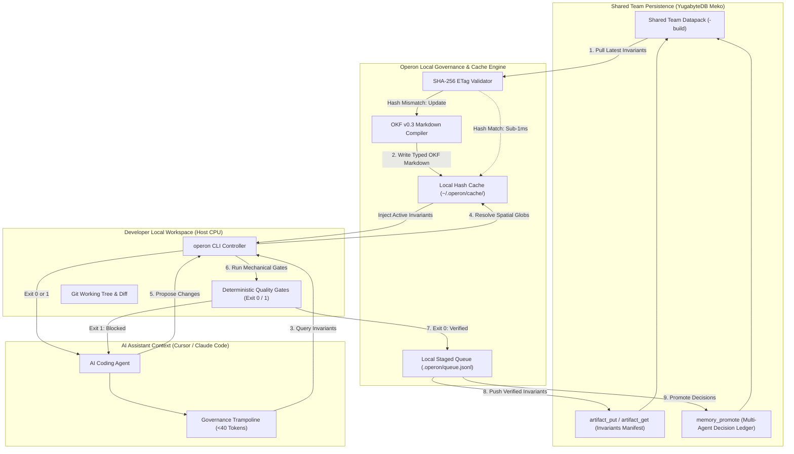

# Operon ↔ Meko Integration Specification (`meko.md`)
**Role:** Distributed Team Persistence & Shared Memory Engine  
**Control Plane:** Operon Host Governance CLI  
**Persistence Engine:** YugabyteDB Meko Datapack (`@yugabytedb/meko-mcp`)  

---

## 1. Core Architecture & Governance Invariant

In an enterprise engineering team, distributed persistence and local code execution must be decoupled:

1. **Operon is the Local Execution Governor:** Operon runs locally on developer workstations, managing git state, enforcing mechanical quality gates (Exit Code `0`/`1`), evaluating spatial invariant globs, and providing sub-15ms local cache reads.
2. **Meko is the Distributed Team Backbone:** Backed by YugabyteDB distributed SQL and vector storage, Meko provides long-term persistence, cross-machine synchronization, and team-wide memory across different developer environments.
3. **The Containment Principle:** The coding agent **never directly interacts with Meko's 42 raw MCP tools**. Exposing raw MCP schemas to agents consumes 16,000–18,500 prompt tokens per turn and causes tool hallucination. Instead, agents interact solely with Operon's local CLI, and Operon bridges to Meko in the background.
4. **Verification Precedes Persistence:** Unverified agent hallucinations are blocked at the host level. Only changes and decisions that pass all Operon verification gates are ever synced to the shared team datapack.

---

## 2. The 3-Endpoint Persistence Interface

While Meko exposes a broad 42-tool surface area for various agent workflows, Operon isolates and interacts strictly with **three core capabilities**:

```
┌────────────────────────────────────────────────────────────────────────┐
│                   OPERON ↔ MEKO PERSISTENCE MATRIX                    │
├───────────────────────┬────────────┬───────────────────────────────────┤
│ Meko Capability       │ Operon Use │ Operational Contract              │
├───────────────────────┼────────────┼───────────────────────────────────┤
│ 1. `artifact_put` /   │ Shared     │ Stores and distributes compiled   │
│    `artifact_get`     │ Invariant  │ OKF invariant manifests as pure   │
│                       │ Ledger     │ JSON blobs. Content-addressed.    │
├───────────────────────┼────────────┼───────────────────────────────────┤
│ 2. `memory_add` +     │ Team       │ Syncs verified architectural      │
│    `memory_promote`   │ Decision   │ decisions across teammates'       │
│                       │ Ledger     │ coding agents in the datapack.    │
├───────────────────────┼────────────┼───────────────────────────────────┤
│ 3. `context_search`   │ Deep Team  │ Fallback query engine when local  │
│    (Optional)         │ History    │ cache misses historical context.  │
├───────────────────────┼────────────┼───────────────────────────────────┤
│ Remaining 39 Tools    │ Shielded   │ Blocked from agent prompt to      │
│                       │            │ eliminate context tax & crashes.  │
└───────────────────────┴────────────┴───────────────────────────────────┘
```

---

## 3. Team-Wide Data Synchronization Lifecycle



### Ingress (Pulling Shared Team Knowledge)
1. On `operon sync --pull` (or background cache refresh), Operon queries `artifact_get` for the team’s `operon-invariants.json`.
2. The SHA-256 hash of the payload is compared against the local cache. If unchanged, Operon completes in `0ms` with **0 tokens consumed and 0 redundant network calls**.
3. If new team invariants exist, Operon parses the JSON payload and compiles them into local **OKF v0.3 Markdown** files in `operon/knowledge/`.
4. Local agents immediately inherit the updated team standards without re-indexing or cloud latency.

### Egress (Publishing Verified Team Knowledge)
1. An agent completes a feature or refactoring milestone.
2. The agent executes `operon verify` and `operon checkpoint "<status>"`.
3. Operon's host gates run locally on the host CPU:
   - **Blast Radius Gate:** Verifies net additions and dependency changes.
   - **File Ceiling Gate:** Checks modified files against team modularity policies.
   - **Sanitary Code Gate:** Detects and flags leftover debug markers.
   - **Spatial Invariants Gate:** Verifies adherence to path-scoped team rules.
4. **Only when all gates return Exit Code `0`**, Operon stages the update into `.operon/queue.jsonl`.
5. Operon pushes the verified state to Meko:
   - Updated invariants are published to `artifact_put`.
   - Architectural decisions are recorded via `memory_add` and promoted to the team's persistent memory via `memory_promote`.

---

## 4. Multi-Agent Team Decision Ledger

A major challenge in multi-agent engineering teams is **cross-agent decision consensus**. When Developer A's assistant makes an architectural decision (e.g., standardizing on constant-time signature comparison or adopting a specific query pattern), Developer B's assistant must not contradict it.

Operon uses Meko's promoted memory subsystem to maintain a **Shared Multi-Agent Decision Ledger**:
* **Step 1 (`memory_add`):** Operon logs the verified decision with full provenance:
  ```json
  {
    "text": "[DECISION][AUTH] Enforced crypto.timingSafeEqual for all bearer tokens.",
    "conversation_id": "operon-sync-session-01",
    "agent_id": "cursor:developer-a",
    "datapack_id": "team-shared-build"
  }
  ```
* **Step 2 (`memory_promote`):** Operon promotes the record to make it permanent and discoverable across all team members' assistants.
* **Result:** When Developer B begins work on an adjacent service, their assistant queries the ledger during `operon boot` and inherits Developer A's architectural decision.

---

## 5. Technical Justification for the Local Cache

Operon’s local cache (`~/.operon/cache/` or `.operon/cache/`) is technically required due to two architectural realities:

1. **Protocol Asymmetry (Absence of Real-Time Push):**  
   Meko operates over request-response protocols (HTTP / SSE / stdio MCP) with no streaming WebSockets or push notifications. Synchronous remote queries on every agent keystroke introduce 2–4 seconds of latency per turn. The local cache acts as a high-speed local read replica.
2. **Resource & Quota Protection:**  
   Standard context accounts impose operational limits on repeated vector queries. Caching invariant manifests by SHA-256 content hashes guarantees that repeated queries across long coding sessions consume 0 unnecessary cloud queries.
3. **Cross-Branch Context Continuity:**  
   By combining local git branch metadata with the cached session Write-Ahead Log (WAL), teammates gain real-time awareness of what other agents are building on shared branches without waiting for remote cloud sync.

---

## 6. Execution Runtime

Operon runs the Meko bridge via an **asynchronous subprocess runner**:
- When `operon verify` succeeds or during background sync, Operon triggers a detached worker using Node.js `child.unref()`.
- The worker flushes staged queue entries to Meko in the background.
- Developer command-line responsiveness remains sub-15ms.
