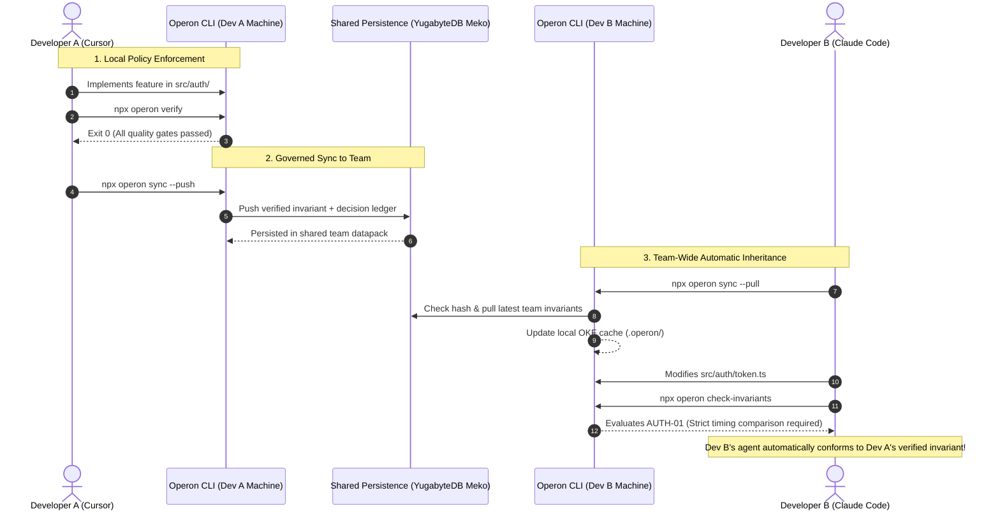

# Operon MVP Specification
**Definition:** The Team-Wide AI Governance Control Plane & Shared Execution Standard  
**Target Architecture:** Cross-Agent Developer CLI + Distributed Team Persistence (YugabyteDB Meko)  
**Core Mission:** Eliminate behavioral divergence, tribal amnesia, and prompt tax across engineering teams by enforcing shared engineering playbooks, deterministic verification gates, and path-scoped codebase memory.

---

## 1. The Core Problem: The AI Governance Crisis in Software Teams

Modern software engineering teams rarely standardize on a single AI coding tool. Engineers across an organization freely choose between Cursor, Claude Code, GitHub Copilot, Codex, and custom CLI agents. This heterogeneity creates a severe governance crisis:

1. **Behavioral Divergence & Review Fatigue:** Every engineer prompts their assistant differently. Without centralized governance, agents introduce conflicting abstractions, import redundant packages for trivial utilities, and ignore team architectural standards. Senior engineers burn exhausting review cycles policing repetitive, unverified AI code.
2. **The Prompt Tax & Context Firehose:** Teams attempt to enforce standards by dumping massive markdown rulebooks into global system prompts (`.cursorrules`, `CLAUDE.md`). This wastes tens of thousands of tokens per turn, degrades model reasoning, and causes instruction drift mid-session.
3. **Tribal Amnesia:** When Developer A fixes an obscure token timing bug in Cursor, Developer B working on Claude Code introduces the exact same bug two hours later. Critical codebase boundaries remain trapped in local chats or senior engineers' heads.
4. **Passive Advice vs. Deterministic Enforcement:** Existing context engines only provide passive natural language advice. Coding agents routinely ignore markdown guidelines because there are no mechanical exit codes (`0` pass, `1` fail) running on the host machine to block non-compliant diffs.

---

## 2. Operon’s Solution: Team-Wide AI Governance

Operon provides a unified host-side control plane that acts as the **single source of truth and execution governor** for all AI coding agents in a team:

```
┌────────────────────────────────────────────────────────────────────────┐
│                   OPERON TEAM GOVERNANCE ARCHITECTURE                  │
├──────────────────────────┬─────────────────────────────────────────────┤
│ Governance Pillar        │ How Operon Enforces It                      │
├──────────────────────────┼─────────────────────────────────────────────┤
│ 1. Universal Harness     │ Injects a uniform <40-token router into all │
│    Standard (`init`)     │ editor configs (Cursor, Claude Code, etc.)  │
├──────────────────────────┼─────────────────────────────────────────────┤
│ 2. Deterministic Quality │ Host-side CPU gates that evaluate git diff, │
│    Gates (`verify`)      │ blast radius, file ceilings, and clean code │
├──────────────────────────┼─────────────────────────────────────────────┤
│ 3. Spatial Invariant     │ Scopes team knowledge strictly to active    │
│    Ledger (`invariants`) │ file paths (`paths: [...]`). Zero bloat.    │
├──────────────────────────┼─────────────────────────────────────────────┤
│ 4. Cross-Agent Session   │ Continuous Write-Ahead Log (WAL) tracking   │
│    Continuity (`session`)│ work in-flight across team branches.        │
├──────────────────────────┼─────────────────────────────────────────────┤
│ 5. Distributed Team      │ Syncs verified invariants and architectural │
│    Persistence (`sync`)  │ decisions to shared YugabyteDB persistence. │
└──────────────────────────┴─────────────────────────────────────────────┘
```

---

## 3. The 5-Feature MVP Scope

For the production MVP, Operon focuses on five foundational capabilities that establish end-to-end team governance:

### Feature 1: Universal Harness Onboarding (`operon init`)
- Scans the repository for installed agent harnesses (`.cursorrules`, `CLAUDE.md`, `AGENTS.md`).
- Injects a standardized, non-invasive 2-line governance trampoline:
  ```markdown
  <!-- OPERON GOVERNANCE TRAMPOLINE START -->
  Before modifying code, query path-scoped team invariants: `npx operon check-invariants`
  Before marking tasks complete, enforce team verification gates: `npx operon verify`
  <!-- OPERON GOVERNANCE TRAMPOLINE END -->
  ```
- Guarantees all developers' assistants operate under the same operational protocol with `<40` prompt tokens of overhead.

### Feature 2: Deterministic Mechanical Gates (`operon verify`)
- Executes on the host CPU in `<15ms`.
- **Gate A (Blast Radius & Package Audit):** Verifies net lines added and blocks unapproved external package manifest additions.
- **Gate B (File Line Ceiling Policy):** Enforces team modularity policies against runaway monolithic file accretion.
- **Gate C (Sanitary Code Enforcement):** Scans git diffs to detect and block temporary debug markers (`console.log`, `debugger`, scratch instrumentation).
- **Exit Codes:** Returns `0` for clean code or `1` with actionable failure diffs, mechanically blocking unverified AI commits.

### Feature 3: Spatial OKF Invariant Ledgers (`operon check-invariants`)
- Evaluates uncommitted changes against typed Open Knowledge Format (OKF v0.3) ledgers stored in `operon/knowledge/*.md`.
- **Spatial Path Scoping (`paths: [...]`):** Instead of dumping the entire repository knowledge base into the LLM, Operon dynamically matches the files touched in `git diff` against path glob patterns.
- Evaluates AST/regex triggers. Exits `1` if an agent introduces a known anti-pattern (e.g., using `==` for cryptographic signatures or omitting tenant isolation filters).

### Feature 4: Continuous Write-Ahead Session WAL (`operon checkpoint` / `operon session`)
- Solves the "End-of-Session Paradox" (agents getting rate-limited or context-compacted without saving state).
- Developers and agents drop micro-deltas (`operon checkpoint "..."`) every 2–3 turns.
- Checkpoints append to local session WAL in `<2ms` without requiring full-file rewrites.
- Teammates run `operon session --team` on shared branches to immediately inherit in-flight context and next steps.

### Feature 5: Distributed Team Sync Bridge (`operon sync`)
- Bridges local developer environments to the shared team persistence layer (YugabyteDB Meko).
- **Verification Precedes Persistence:** Only code and invariants that pass all local verification gates (Exit Code `0`) can be published to the shared team store.
- **Local Hash Cache:** Provides sub-15ms reads for local agents and acts as the real-time context bridge across team members.

---

## 4. End-to-End Governance Data Flow



---

## 5. CLI Command Reference

| Command | Scope | Purpose |
| :--- | :--- | :--- |
| `operon init` | Project | Binds project, creates `.operon/`, and injects universal governance trampolines. |
| `operon check-invariants` | Governance | Lints active git diff against spatial OKF invariant triggers. Exits `1` on violation. |
| `operon verify` | Gate | Evaluates net LOC blast radius, file line ceilings, and sanitary code. Exits `0` or `1`. |
| `operon checkpoint "<msg>"` | Continuity | Appends continuous delta to local session WAL. |
| `operon session [--team]` | Continuity | Resolves in-flight state and latest teammate milestones on the active branch. |
| `operon sync [--push\|--pull]` | Team Sync | Bi-directionally syncs verified invariants and decisions with shared team persistence. |
| `operon bench` | Audit | Runs efficiency benchmark comparing raw MCP overhead vs. Operon-governed execution. |

---

## 6. Directory Layout

```text
operon/
├── bin/
│   └── operon.js             # Global executable entrypoint
├── src/
│   ├── cli.ts                # Command router and CLI controller
│   ├── gates/                # Deterministic Quality Gates
│   │   ├── blast-radius.ts   # Diff line limits & dependency audit
│   │   ├── file-ceiling.ts   # Modular file line policies
│   │   ├── sanitary.ts       # Debug marker detection
│   │   └── invariants.ts     # Spatial path glob & trigger evaluator
│   ├── storage/              # Local Governance Store
│   │   ├── okf-parser.ts     # OKF v0.3 Markdown/YAML parser
│   │   ├── wal-session.ts    # Write-Ahead Log session engine
│   │   └── cache.ts          # Local SHA-256 hash cache manager
│   ├── meko/                 # Shared Team Persistence Bridge
│   │   ├── client.ts         # Lightweight MCP client
│   │   └── bridge.ts         # Invariants manifest & decision sync
│   └── utils/
│       └── git.ts            # High-performance git wrapper
├── knowledge/                # Versioned OKF Invariants
│   └── invariants.md         # Baseline team invariant rules
├── SPEC.md                   # Full Operon Specification
├── meko.md                   # Team Persistence Integration Spec
└── mvp.md                    # This document
```
